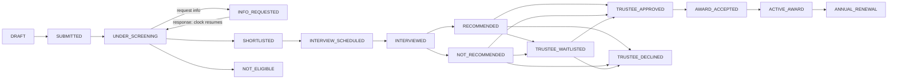

# NWEF Online Application Portal

Production-ready **full-stack skeleton** for the Eng. Nahil Wijesuriya Endowment Fund (NWEF) scholarship portal.

- **Stack:** Next.js 15 (App Router), TypeScript, Prisma, PostgreSQL, Tailwind CSS, Zod, AES-256-GCM field encryption, hash-chained audit log.
- **Auth:** Passwordless OTP (SMS/email) with database-backed sessions and role-specific timeouts.
- **Streams:** Stream A (Old Trinitian Support — **no income/salary fields**) and Stream B (Sports Scholarships).
- **Roles:** Applicant, Admin Officer, Screening Reviewer, Interview Panel, Trustee, Finance Officer, Super Admin.

---

## Quick start

```bash
cp .env.example .env
# edit .env — at minimum DATABASE_URL and all secrets
docker compose up -d postgres
npm install
npm run prisma:generate
npm run prisma:migrate
npm run seed
npm run dev
```

Open http://localhost:3000. In development the OTP is printed to the console and also returned as `devCode` from `POST /api/auth/otp/request`.

Useful commands:

| Command | Purpose |
| --- | --- |
| `npm run dev` | Development server |
| `npm run build && npm start` | Production build/serve |
| `npm run typecheck` | TypeScript validation |
| `npm run lint` | ESLint |
| `npm run test` | Unit tests (workflow, RBAC, scoring, SLA) |
| `npm run prisma:studio` | Database browser |

Seeded staff phones: `+94770000001` … `+94770000006` (Admin → Super Admin). Replace before deployment.

---

## Deploying to Vercel

The production build no longer needs secrets at build time — they are validated on first use at runtime. Add these in **Vercel → Project Settings → Environment Variables** for Production (and Preview if needed):

| Variable | Notes |
| --- | --- |
| `DATABASE_URL` | Pooled PostgreSQL connection string from Neon, Supabase, Vercel Postgres, or another hosted provider. Do **not** use `localhost`. |
| `DIRECT_URL` | Optional but recommended on Neon: the direct/non-pooled connection string. Vercel uses it for Prisma migrations; the app still uses `DATABASE_URL`. For Neon, it is the same URL with `-pooler` removed from the hostname. |
| `OTP_SECRET` | Long random string. Generate with `openssl rand -base64 48`. |
| `SESSION_SECRET` | Different long random string. |
| `AUDIT_SECRET` | Another different long random string. |
| `PDPA_ENCRYPTION_KEY` | Base64-encoded 32-byte key. Generate with `openssl rand -base64 32`. |
| `APP_URL` | Your deployed URL, e.g. `https://nwef.vercel.app`. |
| `STORAGE_DRIVER` | Set to `s3` on Vercel; local `.storage` is ephemeral and not writable. |
| `S3_BUCKET`, `S3_REGION`, `S3_ACCESS_KEY_ID`, `S3_SECRET_ACCESS_KEY` | Required when `STORAGE_DRIVER=s3`. |
| `OTP_DRIVER` | `console` prints codes in Vercel Runtime Logs; `twilio` sends a real SMS. |
| `TWILIO_ACCOUNT_SID`, `TWILIO_AUTH_TOKEN`, `TWILIO_FROM_NUMBER` | Required when `OTP_DRIVER=twilio`. Use the Twilio number in E.164 format, e.g. `+15551234567`. |

After setting them, redeploy. The `prebuild` hook attempts `prisma migrate deploy` only on Vercel, using `DIRECT_URL` when available, so database tables are created automatically once the database is reachable. A migration failure is logged but does not stop the build, so the site stays online while you fix the database setting. Demo staff accounts and annual budgets are seeded automatically on Vercel; set `SEED_ON_DEPLOY=false` to skip. The seed uses upserts and is safe to repeat.

If Vercel blocks Prisma/esbuild install scripts, approve them in the deployment settings or use this build command: `npx prisma generate && npm run build`.

### Temporary demo OTP

For demos only, every verification code is currently fixed to `123456` (override with `DEMO_OTP_CODE`). Remove the `DEMO_OTP_CODE` constant in `src/lib/auth/otp.ts` before real launch — otherwise anyone who knows a phone number can sign in.

### Sending real SMS verification codes

1. Create a free Twilio account at https://www.twilio.com.
2. In Twilio Console, open **Phone Numbers → Manage → Active numbers** and buy a number with SMS capability.
3. Copy **Account SID** and **Auth Token** from the Twilio Console home page.
4. If using a trial account, open **Verified Caller IDs** and verify the mobile number that will receive the OTP.
5. In Vercel, set `OTP_DRIVER=twilio`, `TWILIO_ACCOUNT_SID`, `TWILIO_AUTH_TOKEN`, and `TWILIO_FROM_NUMBER`, then redeploy.
6. Applicant numbers are normalised to E.164, e.g. `0759015289` → `+94759015289`.

If delivery fails, the login form now shows an SMS error instead of pretending the code was sent.

---

## Project structure

```text
prisma/
  schema.prisma              All entities, enums, relations, audit/PDPA models
  seed.ts                    Staff accounts + annual budgets
src/
  app/
    api/                     Route handlers (auth, applications, screening, interviews,
                             trustee, finance, admin, PDPA self-service)
    (pages)                  Applicant portal + 7 role dashboards
  components/
    application/             Wizard, uploader, timeline, booking, e-signature, renewal
    screening/               Checklist reviewer
    interview/               Scorecard, attendance
    trustee/                 Budget tiles, batch approval
    finance/                 Ledger, invoices, payments, award activation
    admin/                   Session scheduler, user/role editor
    layout/ AuthShell, UI primitives
  lib/
    workflow.ts              State machine (single source of truth)
    rbac.ts                  Permission matrix + guards
    sla.ts                   10-day clock with pause/resume
    audit.ts                 Append-only, hash-chained audit writer
    scoring.ts               Weighted 1–5 rubric (per stream)
    budget.ts                Budget tiles and recomputation
    auth/                    OTP + session management
    validation.ts            Zod request schemas
    storage.ts pdf.ts        Local/S3 storage, award-letter PDF
    pdpa.ts                  Field encryption, consent, data-subject requests
  services/                  Business logic (application, screening, interview, trustee, finance, admin)
  middleware.ts              Route presence guard (server-side checks repeated in APIs/pages)
tests/                       Vitest unit tests
docs/ARCHITECTURE.md         Detailed design notes
docs/API.md                  Endpoint reference
```

---

## Workflow pipeline



Every arrow is a `TransitionDefinition` in `src/lib/workflow.ts` with `from`, `to`, allowed roles and guards. All status changes go through `performTransition()`, which writes the timeline event, applies SLA clock rules, runs atomic side effects and appends an audit record **in one database transaction**.

`INFO_REQUESTED` stores `clockPausedAt`; the stored due date is extended by the live pause interval so reviewers never see a false overdue flag. On resume, elapsed paused time is added to `pausedDurationMs` and `slaDueAt` is recomputed (submission + 10 days + total paused time).

---

## Roles at a glance

| Role | Primary capability | Explicitly cannot |
| --- | --- | --- |
| Applicant | Create/edit own draft, upload documents, book interview, respond to info requests, e-sign award, request renewal | Screen, score, approve, record payments, read audit |
| Admin Officer | Manage pipeline, screening, interview sessions, award letters, SLA reports | Trustee decisions, payment posting |
| Screening Reviewer | Screening checklist + eligibility outcome, request information | Score, approve, pay |
| Interview Panel | Independent weighted scorecards, mark attendance | Screen, approve, pay |
| Trustee | Batch approve/waitlist/decline, view budget | Post payments, alter scores |
| Finance Officer | Activate awards, instalments, invoices, payments, budget | Decide awards, screen |
| Super Admin | Full permissions, user/role management, audit & PDPA | — |

Permission logic lives in `src/lib/rbac.ts` and is enforced again by resource-level guards in `src/services/access.ts`. Changing a role or disabling a user revokes all of that user's live sessions.

---

## Security & compliance implemented

- Passwordless OTP with expiry, attempt limits, request rate limiting, single-use challenges.
- DB-backed sessions with HMAC-hashed tokens, `HttpOnly`/`Secure`/`SameSite` cookies and per-role absolute timeouts (Applicant 12h → Trustee/Super Admin 2h).
- Strict RBAC with deny-by-default permission sets and resource ownership/status checks.
- Append-only `AuditLog` with HMAC hash chaining (`verifyAuditChain()`), recording every view, status change, score, decision, payment, upload/download and denial with actor + timestamp.
- PII field encryption helpers (AES-256-GCM) for NIC/bank data; consent records; 30-day PDPA data-subject request register.
- Upload validation: PDF/JPG/PNG only, 10MB cap, MIME allow-list per stream, SHA-256 checksum, private storage (local dev / S3 with SSE in prod).
- Security headers, no-store on document responses, canonical error responses.

Production hardening notes are in `docs/ARCHITECTURE.md`.

---

## Testing

Unit tests cover the state machine guards, clock pause math, RBAC separation, weighted rubrics and SLA flags:

```bash
npm run test
```

---

## Documentation

- [`docs/ARCHITECTURE.md`](docs/ARCHITECTURE.md) — domain model, invariants, deployment hardening checklist.
- [`docs/API.md`](docs/API.md) — endpoint reference with required roles.
